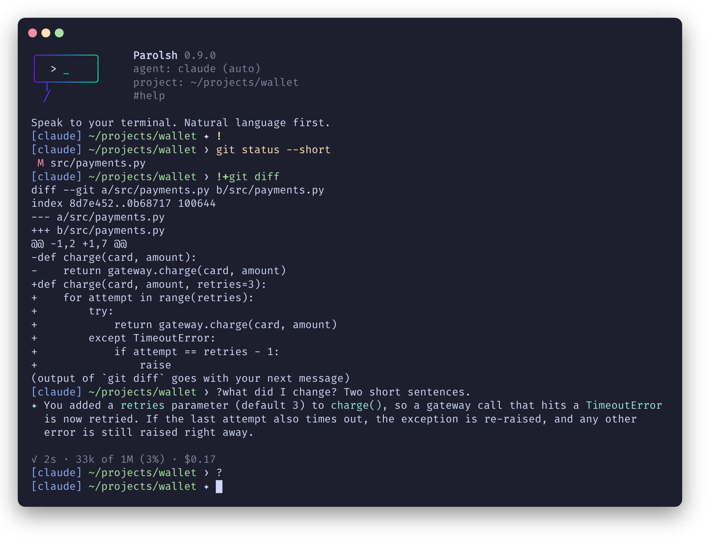

# Input routing

Parolsh never guesses whether a line is English or a shell command. The first
character decides, always:

| Input | Route |
|---|---|
| `text` | The active ACP agent, see [Text](#text) |
| `?text` | The active ACP agent |
| `/command` | The active ACP agent, unchanged, see [Agent slash commands](#agent-slash-commands) |
| `!command` | The configured shell, default `bash -ic`, see [Shell commands](#shell-commands) |
| `!+command` | The same, and its output goes with your next message, see [Sharing a command's output](#sharing-a-commands-output) |
| `!bash` | An interactive Bash session, see [Interactive Bash](#interactive-bash) |
| `#command` | Parolsh itself, see [Parolsh commands](#parolsh-commands) |
| `!` alone | Lock: plain text goes to the shell, see [Shell mode](#shell-mode) |
| `?` alone | Unlock: plain text goes to the agent again |

`find files modified today` is always a question for the agent. To run the
Unix `find`, type `!find . -mtime -1`.

## Shell mode

When you run many commands in a row, `!` alone locks plain text to the
shell, and `?` alone unlocks it. The prompt's last symbol shows where plain
text goes:

```text
[claude] ~/projects/wallet ✦ !
[claude] ~/projects/wallet ❯ git status             ← bash
[claude] ~/projects/wallet ❯ ?why is main behind?   ← the agent
[claude] ~/projects/wallet ❯ ?
[claude] ~/projects/wallet ✦ what changed today?    ← the agent
```

A real session, locked to bash, sharing a diff with the agent, then
unlocked:



| Input | Agent mode `✦` (default) | Shell mode `❯` |
|---|---|---|
| `text` | the agent | the shell, like `!text` |
| `?text` | the agent | the agent |
| `/command` | the agent | the shell (`/usr/bin/ls` runs); `?/command` reaches the agent. `Tab` still completes the agent's commands there, see [Tab completion](#tab-completion) |
| `!command`, `!+command`, `!bash` | the shell | the same |
| `#command` | Parolsh | Parolsh |

Unlike `!bash`, shell mode stays in Parolsh: the agent is a `?` away, `!+`
shares output with it, and `#` commands work. Each command runs in its own
shell, but a `cd` and the variables you export carry over to the next (see
[Shell commands](#shell-commands)). The mode lasts until you change it or leave Parolsh.

To start in shell mode, set `input = "shell"` in `config.toml` (see
[Configuration](configuration.md#keys)), or run `parolsh --input=shell`;
`--input` wins over the file. A project's `.parolsh/config.toml` can set it
too: `#cd` into a project whose `input` differs switches to it. Without an
agent configured, Parolsh always starts in shell mode.

## While you type

On an ANSI terminal the line shows where it will go before you press Enter:

| Line | Color |
|---|---|
| `!command`, `!bash` | yellow |
| `!+command` | green |
| `#command` | magenta |
| `/command` | blue |
| text for the agent | the terminal's color |

In shell mode, plain text is a shell command, so it is yellow too. The marker
(`!`, `!+`, `#`, `/`) is bold. While the line is only a marker, a
dim hint says what it does, for example `!+  run a shell command and send its
output with your next message`. The hint is a tip: the right arrow does not
insert it into the line.

### Tab completion

On `!command` and `!+command` lines, and plain lines in shell mode, `Tab`
completes the word at the cursor,
as bash does: a single match goes into the line, several fill in what they
have in common, and the next `Tab` shows them in a menu (`Tab` and
`Shift+Tab` move through it, `Enter` picks one).

- **The command name** completes from the programs on your `PATH` and, when
  the shell is bash, from the aliases, functions and builtins your
  `~/.bashrc` sets up. That list is read once, in the background, when
  Parolsh starts: an alias added later shows up the next time.
- **A command's arguments** complete as bash would, when the shell is bash
  and [bash-completion](https://github.com/scop/bash-completion) is
  installed: git branches and subcommands, ssh hosts, systemctl units,
  `--flags`. It uses the completions bash-completion ships, those in
  `~/.local/share/bash-completion/completions/` and `~/.bash_completion`,
  but not the ones your `~/.bashrc` defines (`complete -C ...`,
  `source <(kubectl completion bash)`): put those in `~/.bash_completion`
  to get them. `!bash` has your full bash completion.
- **Other words**, and arguments bash-completion has nothing for (or takes
  more than half a second to find), complete as file and directory names,
  from the directory your commands run in. `~/` and absolute paths work, hidden
  files show up when the name starts with `.`, and special characters are
  escaped (`My\ Files`).

On `#` lines, `Tab` completes the command's name (`#a` gives `#agent` and
`#audit`), and after `#cd` a directory, from the directory your commands run
in. `#cd` takes the path as typed, so names with spaces are not escaped there
(`#cd My Projects/`). After `#resume`, `#audit` and `#forget`, it lists this
project's sessions to pick one, see
[Resuming a session](sessions.md#resuming-a-session). The arguments of the
other `#` commands are not completed, including those that take one:
`#agent <name>`, `#pair <agent>`, `#prompt <name>`, `#share <n>`.

In text for the agent (`?text` in shell mode), `Tab` completes `@path` with a
file or directory name from where your commands run, escaped like on a shell
line (`@My\ Notes.md`); see [Mentioning files](#mentioning-files). A `/` that
starts the text completes one of the agent's own commands, see
[Agent slash commands](#agent-slash-commands). Other words of the text have
no completion.

In shell mode a plain line that starts with `/` runs as a shell command, but
`Tab` there still completes the agent's commands, not paths: `/usr/bi<Tab>`
offers the agent's list. Type `!/usr/bi<Tab>` to complete the path.

## Shell commands

<a id="command"></a>

`!command` runs as `bash -ic "<command>"`, in the directory the last
command ended in.

- **Your `~/.bashrc` is loaded**, so aliases, functions and shell options work
  as in your normal terminal. The shell is interactive (`-i`) because a plain
  `bash -c` ignores aliases, and the stock Debian/Ubuntu `~/.bashrc` stops
  right away when the shell is not interactive.
- **A `cd` carries over.** When a command ends, its shell tells Parolsh the
  directory it ended in, and the next command runs there: `cd src`,
  `cd -`, `pushd`, a `cd` before `exit 1`.
- **So do the variables you export.** `export FOO=1`, `unset FOO`,
  `source .envrc`, `nvm use 20`, `source venv/bin/activate`: what a command
  changed in its exported variables is applied again before the next one,
  after your startup files, so it wins over them as in a terminal (the
  virtualenv stays first in `PATH`). For each variable the last value replaces
  the one before.

  ```text
  [claude] ~/projects/wallet ❯ source venv/bin/activate
  [claude] ~/projects/wallet ❯ which python
  /home/joao/projects/wallet/venv/bin/python
  ```

  Only exported variables: a plain `FOO=1`, an alias or a function defined in
  a line is gone when it ends (so a virtualenv's `deactivate` is not there;
  `set -a; source .env; set +a` exports a file of plain `KEY=value` lines).
  `!bash` starts with these changes, and is a session that keeps all of its
  state. There they are set before its startup files run, so a variable your
  `~/.bashrc` sets again (a `PATH` it adds to) takes its value from
  `~/.bashrc`. They are kept in memory until you leave Parolsh, and are not
  given to the agent: it keeps the environment it started with.
- **The agent stays where it is.** A `cd` moves your commands, not the
  conversation: the agent keeps working in the directory it started in, and
  the prompt shows both while they differ:

  ```text
  [claude] ~/projects/wallet ✦ !cd /var/log
  [claude ~/projects/wallet] /var/log ✦ #cd .       ← brings the agent here
  [claude] /var/log ✦
  ```

  `#cd .` starts a new conversation in the directory of your commands. The
  outputs you share with `!+` say where they ran.

  The project stays too: a `cd` does not look for `.parolsh/` again, so its
  configuration is still that of the agent's directory until `#cd` (see
  [Projects](projects.md)).
- The directory comes back through the shell's `EXIT` trap, so the
  `shell` must understand `trap` (bash, zsh, dash do). A command that ends
  with `exec`, or is killed, leaves the directory as it was.
- **Commands stay out of your bash history.** Parolsh sets `HISTFILE=/dev/null`
  for them and keeps its own history.
- A non-zero exit code is printed after the output, for example `exit 1`.
- `Ctrl+C` stops the running command, not Parolsh.
- Parolsh has no job control for your commands (for the agent's turns, see
  [Turns in the background](working-with-agents.md#turns-in-the-background)). With the
  default `bash -ic`, `Ctrl+Z` is handled by that bash, as if you had typed the line in bash: the running program is
  paused (`Stopped`), the rest of the line continues, and the paused program
  ends when the command finishes. With a non-interactive `shell` such as
  `["bash", "-c"]`, Parolsh resumes the command right away. Use `!bash` when
  you need job control.

Loading `~/.bashrc` costs a little time on every command (about 0.17 s on a
typical Ubuntu setup). Anything `~/.bashrc` or `/etc/bash.bashrc` prints also
shows up in the output.

The shell is configurable, see [Configuration](configuration.md):

```toml
shell = ["zsh", "-ic"]
```

## Sharing a command's output

<a id="command-1"></a>

`!+command` runs the command like `!command`, shows its output, and keeps
it for the agent: it is sent with your next message, then forgotten.

```text
[claude] ~/projects/wallet ✦ !+docker ps
CONTAINER ID   IMAGE        STATUS
...
(output of `docker ps` goes with your next message)
[claude] ~/projects/wallet ✦ which of these containers looks unhealthy?
```

The agent answers from that output instead of running the command again.

- Only commands you mark with `!+` are shared: a plain `!command` never
  reaches the agent.
- Several `!+` commands before one message are all sent, in order, each with
  its command, directory and exit code.
- At most the last 16 KB of each output is sent.
- The command's output goes through Parolsh, so programs see a pipe instead
  of a terminal: they print plain text, without colors or pagers. Full-screen
  programs (`vim`, `top`) belong to a plain `!`. Its input is still the
  terminal, so a `sudo` password prompt works.
- `!+` alone shows how to use it.

## Interactive Bash

<a id="bash"></a>

`!bash` opens a real interactive Bash in the directory of your commands,
with your full `~/.bashrc` and completions. `exit` returns to Parolsh, in the directory it was
in before: changes made inside the session stay there.

## Text

In agent mode, a line that does not start with `!` or `#` goes to the agent
(in shell mode, start it with `?`): text is a question, and a line that
starts with `/` is one of the [agent's commands](#agent-slash-commands).
The answer is printed as it arrives, with a status line showing what the
agent is doing (see [During a turn](working-with-agents.md#during-a-turn)).
`Ctrl+C` cancels the turn.

### Mentioning files

`@path` names a file or directory for the agent:

```text
[claude] ~/projects/wallet ✦ why does @src/api/client.rs retry twice?
```

The text goes as typed, and each `@path` that exists goes with it as a link
(an ACP `resource_link` with the absolute `file://` path), which the agent
reads itself. Paths start where your commands run, the directory the prompt
shows; `~/` and absolute paths work.

After a `cd` took your commands away from the agent's directory, that is
still where `@` starts and what Tab completes:

```text
[claude ~/projects/wallet] ~/projects/wallet/infra ✦ why does @deploy.yaml fail?
```

The link is `infra/deploy.yaml`. The agent would read the word `@deploy.yaml`
from its own directory, so it gets it in full, `@/home/you/projects/wallet/infra/deploy.yaml`,
while the history keeps what you typed.

`@words` that name nothing (`@team`, an email address) are only text, and
punctuation right after a path (`@notes.txt.`) is not part of it. `#audit`
shows how many files a message linked.

Not on `!` lines: there, `@` is the shell's.

## Agent slash commands

<a id="command-2"></a>

Lines starting with `/` belong to the agent. Parolsh reserves no `/` commands
and forwards the line as typed, so the agent's own slash commands work.

`Tab` completes them, from the list the agent itself sends when a
conversation opens, and again when it changes:

```text
[claude] ~/projects/wallet ✦ /co<Tab>
/compact  Compact the conversation ([instructions])
/cost     Show what the session cost
```

- One match goes into the line; several show in a menu, each with what the
  agent says of it and, in parentheses, what it takes after its name.
- They are the running agent's, and they differ: `/compact` for Claude,
  Codex, OpenCode and Goose, `/compress` for Qwen Code. Those five and Kilo
  Code send their list, with their skills in it; an agent that sends none has
  nothing to complete. A command the agent takes without listing it (Kilo's
  `/compact`) still works when typed.
- Only the command's name, where it starts the text for the agent (after `?`
  in shell mode). What follows it is not completed, and `/` elsewhere in a
  sentence is a path like any other word.

## Parolsh commands

<a id="command-3"></a>

Lines starting with `#` are Parolsh's own commands; `#help` lists them.

| Command | What it does |
|---|---|
| `#help` | Show the input rules and commands |
| `#new` | Start a new conversation with the agent, in the agent's directory |
| `#new private` | Start a new conversation that is not saved in the [history](sessions.md#the-history-of-sessions), until the next `#new`, `#cd`, `#agent` or `#resume` |
| `#cd <path>` | Change Parolsh's directory, for the agent and your commands, and start a new conversation there. `~` and relative paths work, from the directory of your commands, so `#cd .` brings the agent where a `cd` took them; no path means your home directory. Reloads the configuration of the project found there. The agent in use stays when that project configures it, which agents defined in the global file always are, even if the project's `default_agent` names another; only when it is not configured there does the project's `default_agent` take over. The agent restarts when its settings (`mode`, `options`) differ there. |
| `#agent` | Show the agent in use |
| `#agent list` | List configured agents; `*` marks the one in use |
| `#agent <name>` | Switch to another configured agent, with a new conversation. `default_agent` does not change. |
| `#options` | Show the running agent's options, `*` on the current values |
| `#options <id> <value>` | Set one of the agent's options for the running agent process; a new process takes the configuration's again, see [Options](agents.md#options) |
| `#config` | Show the configuration files in use, and whether they exist |
| `#config sample` | Print the full sample configuration |
| `#prompt` | Show the prompt style in use |
| `#prompt <name>` | Switch the prompt: `parolsh`, `starship` or `minimal`, until you leave Parolsh |
| `#project` | Show the project root |
| `#project init` | Create `.parolsh/` in Parolsh's directory, the agent's: after a `cd` moved your commands away, not the one they are in. See [Projects](projects.md) |
| `#audit` | What happened since Parolsh started, see [`#audit`](sessions.md#audit) |
| `#audit <n>` | What happened in session `n`, of any project, from the [history](sessions.md#the-history-of-sessions) |
| `#sessions` | The sessions of this project saved in the [history](sessions.md#the-history-of-sessions), newest first; `*` marks the current one |
| `#sessions <text>` | The ones where the text was said, or that it titles, see [Finding a session](sessions.md#finding-a-session) |
| `#sessions all [text]` | The same over every project |
| `#sessions agent` | The conversations the running agent itself has for this directory, also the ones it had outside Parolsh. See [A conversation the agent had elsewhere](sessions.md#a-conversation-the-agent-had-elsewhere) |
| `#forget [n]` | Remove session `n` of this project from the history, after asking; the current one without `n` |
| `#resume <n>` | Go back to session `n` with its agent, in its directory: the agent remembers that conversation, and what follows is saved in it. Claude, Codex and OpenCode can; an agent that cannot says so. A session of another project is resumed after asking |
| `#resume <text>` | Go back to the one session of this project that has the text; `#resume all <text>` looks in every project |
| `#resume agent <text>` | Go back to one of the agent's own conversations, by its title or the start of its id; it is recorded as a session |
| `#cast` | List your [spells](spells.md): operations kept as a script and its instructions |
| `#cast <name> [args]` | Ask the agent to cast a spell, with what follows its name; asking in your own words works too. See [Spells](spells.md#asking-for-one) |
| `#share [n]` | Let the agent of this conversation read session `n` of another project with its history tools; without `n`, what is shared. See [Sharing a session of another project](sessions.md#sharing-a-session-of-another-project) |
| `#redraw [n]` | Clear the terminal and show the last `n` exchanges of the conversation again (5 without `n`), see [Showing the conversation again](sessions.md#showing-the-conversation-again). `Ctrl+L` does the same |
| `#copy [n]` | Copy the last answer to the clipboard as the agent wrote it; `n`: an earlier one (2 is the one before). `Alt+C` copies the last. See [Copying an answer](#copying-an-answer) |
| `#copy code` | Copy the last code block of the last answer |
| `#raw [n]` | Print the last answer, or an earlier one, without the layout of the screen |
| `#jobs` | The agent's turns sent to the background with `Ctrl+Z`, see [Turns in the background](working-with-agents.md#turns-in-the-background), and the [spells in the background](spells.md#spells-in-the-background) |
| `#fg [n]` | Wait for background turn `n`, or the last one. `Ctrl+C` cancels it, `Ctrl+Z` goes back to the prompt |
| `#pair <agent>` | Pair with a second agent: your next message is the issue, for both, and it answers what the agent says when it stops, once you agree. See [Pairing two agents](working-with-agents.md#pairing-two-agents) |
| `#pair <agent> <text>` | Ask the second agent something of its own ("review the tests"): the agent is not sent it, and the second agent starts at once with what the agent answered last |
| `#pair [off]` | Show the second agent, or stop pairing |
| `#decide` | Ask the second agent again about what the agent said last |
| `#exit` | Leave Parolsh (`Ctrl+D` also works). While a turn or a task of the agent runs in the background, the first one says so and stays: leaving stops them |

## Copying an answer

On screen an answer is laid out for reading: a mark, an indent, lines broken
at the terminal's width. A selection with the mouse takes all of that with
it. `#copy`, or `Alt+C`, puts the last answer on the clipboard as the agent
wrote it, its markdown and nothing else:

```text
[claude] ~/projects/wallet ✦ #copy
The last answer is on the clipboard (12 lines, with xclip).
[claude] ~/projects/wallet ✦ #copy code
The last code block of the last answer is on the clipboard (3 lines, with xclip).
```

- `#copy 2` is the answer before the last, and so on, for the last 20 of
  this run. An answer is all the agent wrote in a turn; a turn that ended in
  the background counts when it is reported.
- `#copy code` takes the last fenced block of the last answer, without its
  fence: the command to run, the file to save.
- `#raw [n]` prints the same text instead, to select it with the mouse.

Parolsh gives the text to the program of your desktop: `wl-copy` on Wayland,
`xclip` or `xsel` on X11, `pbcopy` on macOS. Without one, as over SSH, it asks
the terminal to take it (an OSC 52 request): kitty, WezTerm, Alacritty, foot,
iTerm2, Windows Terminal and tmux do; GNOME Terminal and other VTE terminals
do not, and say nothing. `clipboard` in the
[global configuration](configuration.md#keys) sets another command.

The answers are kept in memory, not read back from the history: after
Parolsh restarts, `#copy` has the answers of the new run only.

## Moved sections

Sessions and history have [a page of their own](sessions.md). The sections
that were here:

- <a id="audit"></a>[`#audit`](sessions.md#audit)
- <a id="the-history-of-sessions"></a>[The history of sessions](sessions.md#the-history-of-sessions)
- <a id="finding-a-session"></a>[Finding a session](sessions.md#finding-a-session)
- <a id="resuming-a-session"></a>[Resuming a session](sessions.md#resuming-a-session)
- <a id="a-conversation-the-agent-had-elsewhere"></a>[A conversation the agent had elsewhere](sessions.md#a-conversation-the-agent-had-elsewhere)
- <a id="showing-the-conversation-again"></a>[Showing the conversation again](sessions.md#showing-the-conversation-again)
- <a id="a-turn-in-the-background"></a>[A turn in the background](sessions.md#a-turn-in-the-background)
- <a id="usage-in-the-database"></a>[Usage in the database](sessions.md#usage-in-the-database)
- <a id="the-agent-can-search-the-history"></a>[The agent can search the history](sessions.md#the-agent-can-search-the-history)
- <a id="sharing-a-session-of-another-project"></a>[Sharing a session of another project](sessions.md#sharing-a-session-of-another-project)
